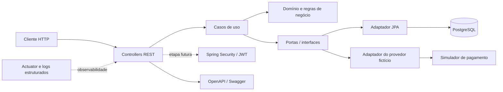
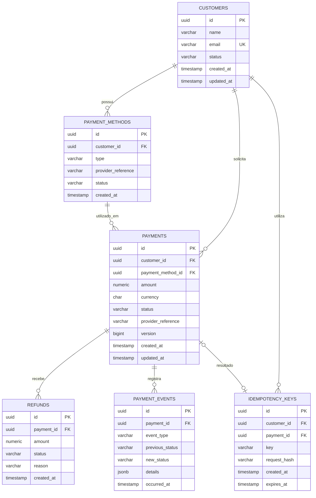

# Payment Processing API

API REST de processamento de pagamentos fictícios, desenvolvida como projeto de portfólio para demonstrar práticas de backend Java aplicadas a sistemas financeiros.

O sistema será construído incrementalmente. Este README documenta as decisões arquiteturais e o escopo planejado; os componentes descritos como futuros ainda não estão implementados.

## Objetivos

- Implementar fluxos de clientes, pagamentos, eventos e estornos.
- Exercitar consistência financeira, idempotência, concorrência e auditoria.
- Ter uma base testável, observável e preparada para evolução.
- Usar um provedor de pagamentos fictício. Não armazenar números reais de cartão, CVV ou outros dados sensíveis.

## Arquitetura

### Monólito modular com princípios de Clean Architecture

O projeto começará como um **monólito modular**, organizado por domínios de negócio e com separação entre regras de negócio, casos de uso e adaptadores técnicos.

Essa arquitetura foi escolhida porque:

- **Mantém a operação simples no início:** uma aplicação e uma implantação reduzem o custo operacional e a quantidade de infraestrutura necessária enquanto as regras ainda estão evoluindo.
- **Cria limites explícitos entre domínios:** módulos como `customer`, `payment` e `refund` agrupam suas responsabilidades e reduzem o acoplamento.
- **Protege as regras de negócio de detalhes técnicos:** o domínio não deve depender diretamente de HTTP, Spring Data JPA, PostgreSQL ou do provedor de pagamentos.
- **Facilita testes:** casos de uso podem ser testados isoladamente, enquanto adaptadores e persistência são cobertos por testes de integração.
- **Permite evolução sem antecipar microsserviços:** extração de serviços poderá ser considerada quando houver necessidades reais de escala, autonomia de implantação ou isolamento operacional.

Microsserviços não serão usados inicialmente: sua complexidade de comunicação, observabilidade e consistência distribuída não se justifica antes de termos domínios e limites bem compreendidos.

### Visão da arquitetura



Controllers traduzem requisições HTTP para operações da aplicação. Casos de uso coordenam o fluxo e dependem de portas/interfaces para acessar persistência e integrações. Adaptadores implementam essas portas. As regras do domínio permanecem independentes desses detalhes.

### Estrutura de módulos planejada

```text
paymentprocessing/
├── customer/
├── payment/
├── refund/
├── transaction/
├── notification/
├── security/
└── shared/
```

Dentro dos módulos, a organização será por responsabilidade, conforme a necessidade:

```text
<modulo>/
├── adapter/
│   ├── in/web/
│   └── out/
├── application/
│   └── port/
│       ├── in/
│       └── out/
└── domain/
```

DTOs, mappers, persistência e tratamento de erros ficarão próximos ao módulo que os utiliza. O módulo `shared` será restrito a componentes genuinamente compartilhados, evitando dependências genéricas entre domínios.

## Modelo de dados inicial

O esquema será criado e versionado com Flyway. O diagrama abaixo é uma proposta inicial e poderá ser refinado antes da primeira migração.



### Decisões de consistência planejadas

- Valores monetários serão representados por `BigDecimal` na aplicação e `NUMERIC` no banco; pagamentos terão moeda explícita.
- Identificadores serão UUIDs e estados serão representados por enums.
- A chave de idempotência será única por cliente (`customer_id`, `key`). O hash da requisição permitirá detectar o uso da mesma chave com conteúdo diferente.
- Pagamento e eventos relacionados serão persistidos atomicamente.
- O controle otimista de concorrência (`@Version`) será o ponto de partida. Operações concorrentes de estorno serão avaliadas para uso de bloqueio pessimista e testadas com PostgreSQL.
- Chamadas a um provedor real não devem ocorrer dentro de transações longas. O fluxo inicial usará um simulador; evolução assíncrona e Outbox ficam para etapa posterior.
- Regras de estorno parcial ou múltiplo serão definidas antes da implementação dos casos de uso.

## API planejada

Os endpoints abaixo são objetivos da implementação, não estão disponíveis ainda.

| Método | Endpoint | Objetivo |
|---|---|---|
| `POST` | `/api/v1/customers` | Cadastrar cliente |
| `GET` | `/api/v1/customers/{id}` | Consultar cliente |
| `GET` | `/api/v1/customers` | Listar clientes |
| `POST` | `/api/v1/payments` | Solicitar pagamento |
| `GET` | `/api/v1/payments/{id}` | Consultar pagamento |
| `GET` | `/api/v1/payments` | Consultar histórico de pagamentos |
| `POST` | `/api/v1/payments/{id}/refunds` | Solicitar estorno |
| `GET` | `/api/v1/payments/{id}/events` | Consultar eventos do pagamento |

As APIs serão documentadas com OpenAPI/Swagger. Respostas de erro serão padronizadas e usarão códigos HTTP adequados.

## Stack planejada

| Tecnologia | Responsabilidade |
|---|---|
| Java 21 | Linguagem da aplicação |
| Spring Boot 3, Spring Web | Inicialização e API REST |
| Spring Data JPA, Hibernate | Persistência relacional |
| PostgreSQL | Banco de dados |
| Flyway | Versionamento do esquema |
| Spring Validation | Validação de entrada |
| JUnit 5, Mockito | Testes unitários |
| Testcontainers | Testes de integração com PostgreSQL |
| RestAssured | Testes de API |
| Spring Security e JWT | Autenticação e autorização, em etapa posterior |
| Spring Boot Actuator | Saúde e métricas operacionais |
| OpenAPI / Swagger | Documentação da API |
| Docker / Docker Compose | Ambiente local e containerização |
| GitHub Actions | Pipeline de CI |
| Apache Kafka | Mensageria, em etapa de evolução |

As dependências serão adicionadas gradualmente, quando a etapa correspondente for iniciada. Spring Security/JWT e Kafka não fazem parte da fundação inicial.


## Testes planejados

- **Unitários:** regras de pagamento e estorno, valores, transições de estado e erros.
- **Integração:** persistência, relacionamentos, migrações e rollback usando PostgreSQL via Testcontainers.
- **API:** fluxos de sucesso e erro, incluindo cliente inexistente, pagamento duplicado e estorno inválido.
- **Consistência:** idempotência, concorrência, race conditions e falhas durante o processamento.
- **Segurança:** chamadas autenticadas e não autenticadas após a implementação de JWT.

